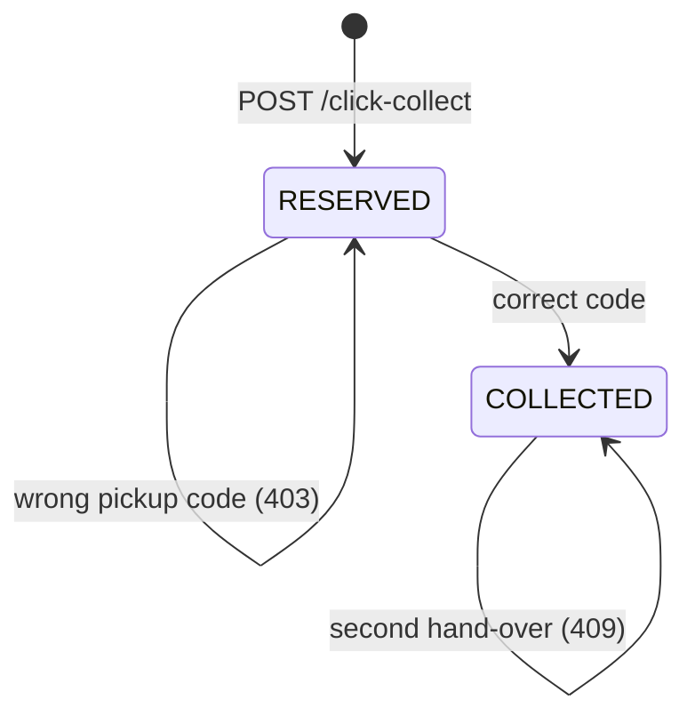

# Postman + Newman · Retail Store Ops API

[](https://github.com/mukeshn/postman-newman-retail-api/actions/workflows/newman.yml)
[](https://mukeshn.github.io/postman-newman-retail-api/)


[](LICENSE)

A Postman collection for a retail store operations backend (store finder, inventory, CSV import/export, click & collect). It runs headless in CI with Newman, and the **htmlextra** report is published to GitHub Pages.

> Import `collections/retail-store-ops.postman_collection.json` and `environments/local.postman_environment.json` into Postman to explore it interactively.

| Folder | Requests | Techniques |
|---|---|---|
| Stores | list, nearest by geo, 404 | chaining (`storeId`), sort-order assertion |
| Inventory | read, receive, negative stock, invalid reason, CSV import/export | JSON schema (`pm.response.to.have.jsonSchema`), variables between requests |
| Click & Collect | reserve, wrong code, hand over, double hand-over, unavailable | pre-request scripts for unique data, state machine checks |

A collection-level test enforces a **1s response-time budget** on every request.



```bash
npm ci
npm run sut &     # bundled API on :4173
npm test          # cli + htmlextra (reports/index.html) + junit
```
